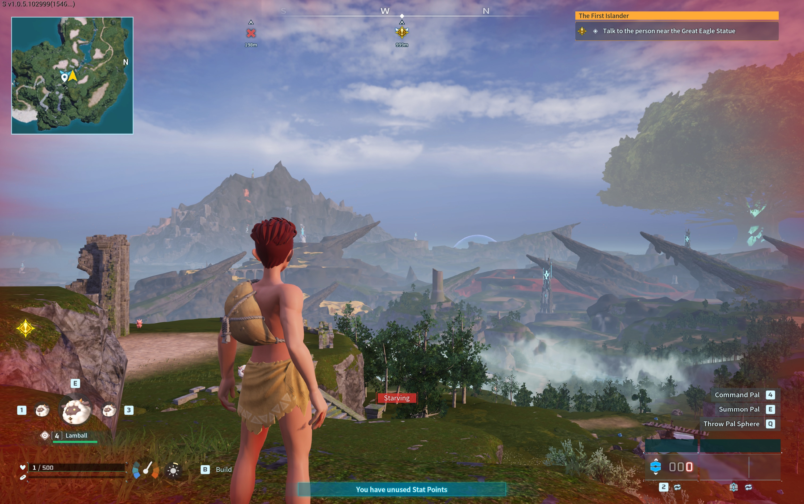

# Palworld Mods

Add a native **Mods** menu and a configurable **Minimap** to Palworld on Mac.
Install one app, then manage your mods inside the game's own settings.

**[Download for Mac](https://github.com/lansbe/palworld-mods/releases/latest)** ·
[Installation](#install-in-five-steps) · [Help](#need-help) · [Contributing](CONTRIBUTING.md)

*Options → Mods, with native tabs across the top. No separate management window.*

## Before you start

You need an **Apple silicon Mac**, **macOS 14 or later**, and your own installed
copy of the **Mac App Store edition of Palworld**. The supported version is
App Store app **1.0.8**, game build **102999**. Intel Macs, Windows, Xbox and
other game distributions are not supported installation targets.

You do not need Git, Terminal, Python, a GitHub account or the other repositories
to play with Minimap. The game itself is not included.

## Install in five steps

1. **Quit Palworld** if it is running.
2. Open the **[latest release](https://github.com/lansbe/palworld-mods/releases/latest)**.
   Under **Assets**, download the file ending in **-macos-arm64.dmg**.
   Choose the **.dmg**, not **Source code**, the update **.zip**, or a checksum file.
3. Open the disk image. **Drag Palworld Mods into Applications**, wait for the
   copy to finish, then eject the disk image in Finder.
4. Open **Palworld Mods** from Applications. It launches your installed game
   with mods. Use this app whenever you want to play with mods.
5. Open **Options → Mods**. Load a world and close the menus: **Minimap is already
   installed and enabled**.

**Success looks like this:** the Mods category appears in settings and a map
appears in the upper-left corner while playing.

*Change the map from Options → Mods → Minimap.*

### If macOS asks for approval

Current downloads are ad hoc signed, not Apple-notarized. After attempting to
open the app, macOS may offer **System Settings → Privacy & Security → Open
Anyway**. Only approve the release you chose to trust. See
[Apple's instructions](https://support.apple.com/en-ca/102445); disabling system
security is not part of installation.

## Use the menu

| I want to… | Open Options → Mods, then… |
| --- | --- |
| Change the map | Select the **Minimap** tab for shape, camera follow, range, transparency and icons. |
| Hide a mod temporarily | Select the mod's tab and turn **Enabled** off. |
| Install or remove a bundled mod | Open the **Manage mods** tab and select the mod. A gray tab also installs the missing mod when selected. |
| Try automatic capture/gathering | Install **Autonomy** and read its [first-session guide](https://github.com/lansbe/palworld-mod-autonomy#try-it-in-a-test-world). |
| Change the language | Open **Manage mods → Language**. Automatic follows the game; a manual choice is remembered. |
| Check or install an app update | Select the **Updates** tab. Automatic updates are on by default and can be turned off. |

Installing, removing, enabling and configuring bundled mods applies without
restarting the game. App/runtime updates take effect after a normal game exit;
they never forcibly restart an active session. Automatic updates download in
the background. Manual checking and installation remain available when disabled.
Public updates require no account; an optional GitHub connection is available
if anonymous requests are rate-limited.

The menu and bundled mods support all **17 Palworld locales**. The shared language
choice persists across launches and updates without changing the game's language.

## Which project do I need?

| Project | What it does | Install separately? |
| --- | --- | --- |
| **Palworld Mods** (this repository) | The Mac app, runtime, Mods menu and updater. | **Start here.** |
| [Minimap](https://github.com/lansbe/palworld-mod-minimap) | Terrain, guild markers, points of interest and routes. | No. Included and enabled. |
| [Autonomy](https://github.com/lansbe/palworld-mod-autonomy) | Experimental local capture and gathering controller. | Install from **Manage mods**. |
| [MCP](https://github.com/lansbe/palworld-mcp) | Connect an AI client to supported game controls. | Optional separate download, for AI control only. |

## Need help?

| What you see | What to check |
| --- | --- |
| There is no Mods category | Quit the game, then launch **Palworld Mods**, not the original **Palworld** app. Check the supported game build above. |
| Minimap is missing | Load a world, close the menus and check **Minimap → Enabled**. It hides during loading and at the title screen. |
| A guild member is missing | They must be inside the visible map area and replicated to your client by the host. |
| Mods stop working after a game update | Unknown builds are disabled deliberately. Wait for a compatible release; do not force an older profile. |
| Multiplayer is slow or times out | The runtime does not replace the game's network connection or host replication. |

Still stuck? [Open an issue](https://github.com/lansbe/palworld-mods/issues) with
your app version, game build, macOS version and steps to reproduce. Review any
screenshots or diagnostic excerpts for personal information before sharing them.

## Your game and data

The separate **Palworld Mods.app** does not replace the licensed **Palworld.app**
or delete your saves. Launch the original app to play without mods. To uninstall,
quit the game and move **Palworld Mods** from Applications to the Trash.

Mod settings, the local control socket and bounded logs live in your user's
Application Support/PalworldMods folder. Nothing is uploaded automatically.
Game logs and collected macOS crash reports can contain player information;
review them before sharing. Keeping this folder preserves settings for a reinstall.

## Build or contribute

Players can use the download above. Contributors can start with
[CONTRIBUTING.md](CONTRIBUTING.md) and the [source build guide](docs/development.md).
The loader, launcher and menu are original code, with bundled Lua 5.4 and no
external mod manager or background Python service.

[Architecture](docs/architecture.md) · [Distribution](docs/distribution.md) ·
[Updates](docs/updates.md) · [Localization](docs/localization.md) ·
[Validation](docs/validation.md) · [Security](SECURITY.md)

## License

Original code is [MIT-licensed](LICENSE). Dependencies retain their
[third-party notices](THIRD_PARTY_NOTICES.md). This is an independent community
project, not an official Pocketpair product. Palworld and the game content shown
in the [real screenshots](docs/screenshots/README.md) belong to their respective owners.
